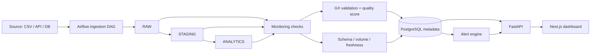

# DataGuard – Data Quality & Observability Platform


> **🚧 Work in progress.** DataGuard is an individual portfolio project that I am actively designing and building.
> The requirements are complete; implementation is starting. See the [status table](#project-status) for what exists today.

## What is DataGuard?

DataGuard is a centralized platform that monitors data pipelines, validates datasets, tracks freshness, detects schema and volume changes, and raises actionable alerts through a web dashboard.

Data pipelines often finish "successfully" while loading duplicate rows, renamed columns, or half the usual volume. DataGuard is designed to catch these silent failures by answering five questions:

1. Is the data **correct**?
2. Is the data **complete**?
3. Is the data arriving **on time**?
4. Are the **pipelines** running successfully?
5. Has the dataset **changed unexpectedly**?

## Planned features (MVP)

- **Dataset management:** register datasets, owners, source systems, layers, and schemas
- **Data quality rules:** NOT NULL, uniqueness, data type, accepted values, numeric range, referential integrity, custom SQL, schema checks
- **Quality engine:** validations executed with Great Expectations, with stored run history
- **Quality score:** transparent, configurable scoring across completeness, uniqueness, validity, and consistency
- **Freshness monitoring:** expected refresh schedules, thresholds, and delayed-dataset detection
- **Schema change detection:** snapshots compared across runs (added, removed, type-changed columns)
- **Volume anomaly detection:** threshold and rolling-history checks on row counts
- **Pipeline observability:** Apache Airflow DAG and task status, duration, and retries
- **Alerting:** in-app alerts with severity, deduplication, acknowledge, and resolve
- **Dashboard:** overview, dataset details, pipeline monitoring, quality issues, alerts, and configuration pages

## Planned architecture

Data moves through a layered **RAW → STAGING → ANALYTICS** architecture (DuckDB). Platform metadata, results, and alerts are stored in PostgreSQL.



*This is the planned design. It is subject to change as the project evolves.*

## Tech stack

| Area | Technology |
|------|-----------|
| Language | Python 3.12+, SQL, Pandas |
| Orchestration | Apache Airflow |
| Data quality | Great Expectations (GX Core), pytest |
| Databases | PostgreSQL (metadata), DuckDB (analytics layers) |
| Backend | FastAPI, Pydantic, SQLAlchemy, Alembic |
| Frontend | Next.js, TypeScript, Tailwind CSS |
| Infrastructure | Docker, Docker Compose |
| Later | GitHub Actions, OpenLineage, Marquez, Prometheus, Grafana |

## Project status

| Phase | Status |
|-------|--------|
| 1. Requirement analysis | ✅ Done ([docs/requirements.md](docs/requirements.md)) |
| 2. Architecture and system design | 🔜 Planned |
| 3. Database design | 🚧 In progress ([design](docs/database-design.md)) |
| 4. Infrastructure setup (Docker) | ✅ Done (PostgreSQL, FastAPI, Airflow, Next.js) |
| 5. Data engineering (RAW/STAGING/ANALYTICS) | 🔜 Planned |
| 6. Data quality engine | 🔜 Planned |
| 7. Observability (freshness, schema, volume, Airflow) | 🔜 Planned |
| 8. Backend development | 🔜 Planned |
| 9. Frontend development | 🔜 Planned |
| 10. Integration and testing | 🔜 Planned |
| 11. CI/CD and documentation | 🔜 Planned |
| 12. Advanced enhancements | 🔜 Planned |

See [docs/ROADMAP.md](docs/ROADMAP.md) for details.

## Repository structure

```
dataguard/
├── backend/          # FastAPI application (planned)
├── frontend/         # Next.js dashboard (planned)
├── airflow/dags/     # Airflow DAGs (planned)
├── data/sample/      # E-commerce demo data with seeded issues (planned)
├── docker/           # Dockerfiles and compose helpers (planned)
├── tests/            # pytest suites (planned)
├── docs/
│   ├── requirements.md
│   ├── ROADMAP.md
│   ├── adr/          # Architecture Decision Records
│   └── diagrams/     # Architecture diagrams (planned)
├── .env.example
└── README.md
```

## Demo plan

The demo uses an e-commerce dataset (customers, orders, order_items, products, payments) with intentional problems: duplicate order IDs, missing customer IDs, invalid totals, wrong data types, unexpected columns, delayed ingestion, sudden row-count changes, and orphaned relationships. DataGuard should detect each one and show it in the dashboard.

## Getting started

Prerequisites: Docker Desktop.

```bash
cp .env.example .env      # then edit the passwords and the JWT secret
docker compose up --build
```

| Service | URL |
|---|---|
| Dashboard | http://localhost:3000 |
| API docs | http://localhost:8000/docs |
| Airflow | http://localhost:8080 |

## License

MIT, see [LICENSE](LICENSE).
