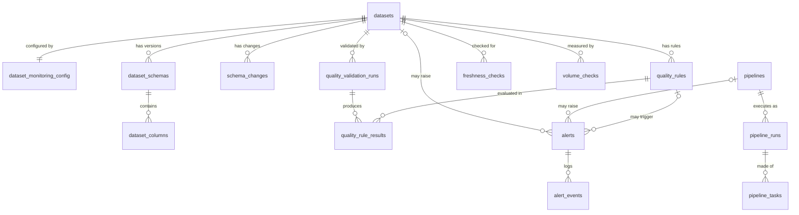

# DataGuard – Database Design

- **Status:** Approved
- **Date:** 2026-11-08
- **Scope:** PostgreSQL database `dataguard` (platform metadata and operational records).
  Monitored data (RAW / STAGING / ANALYTICS) lives in DuckDB and is not described here.

## 1. Design decisions

| ID | Decision | Rationale |
|----|----------|-----------|
| DB1 | Primary keys are `BIGINT` identity columns | Simple, fast, readable. UUIDs add little value without distributed writers |
| DB2 | All timestamps are `timestamptz`, stored in UTC | Avoids timezone ambiguity; matches Airflow |
| DB3 | Fixed-choice columns use `VARCHAR` + `CHECK`, mirrored by Python enums | Native PostgreSQL ENUMs are hard to alter in migrations |
| DB4 | Rule parameters are one `JSONB` column validated by Pydantic per rule type | New rule types need no migration. The app layer, not the DB, enforces the JSON shape |
| DB5 | Tables `pipelines` and `dataset_monitoring_config` are added beyond the initial entity list | Avoids repeating DAG names per run; groups the settings edited on the Configuration page |
| DB6 | Owners are plain text columns (`owner_name`, `owner_email`) | A `users` table is only needed once authentication exists (postponed) |
| DB7 | Alert deduplication is enforced by a partial unique index | Guarantees one active alert per incident even under concurrent checks |
| DB8 | Deleting a dataset or pipeline cascades to its history; the UI offers "disable monitoring" instead | Clean history without soft-delete complexity |

## 2. Conventions

- Table names: plural `snake_case`. Primary key: `id`. Foreign keys: `<singular_table>_id`.
- Tables that users edit have `created_at` and `updated_at` (`timestamptz`, default `now()`).
- Fixed-choice columns carry a `CHECK` constraint listing the allowed values.
- Every foreign key column is indexed (PostgreSQL does not do this automatically).
- Constraints and indexes get explicit, predictable names (`pk_`, `fk_`, `uq_`, `ck_`, `ix_`) through a SQLAlchemy naming convention, so Alembic can reliably alter them.

## 3. Tables

### 3.1 Dataset management

**`datasets`**: one row per monitored table.

| Column | Type | Notes |
|---|---|---|
| id | BIGINT PK | identity |
| name | VARCHAR(255) NOT NULL | |
| layer | VARCHAR(20) NOT NULL | CHECK: raw, staging, analytics |
| description | TEXT | |
| source_type | VARCHAR(30) NOT NULL | CHECK: api, database, csv, application |
| source_name | VARCHAR(255) | |
| owner_name | VARCHAR(255) | |
| owner_email | VARCHAR(255) | |
| location | VARCHAR(500) NOT NULL | for example `raw.orders` in DuckDB |
| monitoring_enabled | BOOLEAN NOT NULL | default true |
| created_at, updated_at | timestamptz NOT NULL | |

Unique: (`layer`, `name`).

**`dataset_monitoring_config`**: 1:1 with `datasets`; the thresholds edited on the Configuration page.

| Column | Type | Notes |
|---|---|---|
| dataset_id | BIGINT PK, FK → datasets | ON DELETE CASCADE |
| expected_refresh_minutes | INTEGER NOT NULL | default 1440; CHECK > 0 |
| freshness_threshold_minutes | INTEGER NOT NULL | default 2880; CHECK >= expected_refresh_minutes |
| timestamp_column | VARCHAR(255) | optional column used to measure freshness |
| volume_change_threshold_pct | NUMERIC(6,2) NOT NULL | default 50; CHECK > 0 |
| volume_history_window | INTEGER NOT NULL | default 7; CHECK > 0 (past checks forming the baseline) |
| volume_min_rows | BIGINT NOT NULL | default 1; CHECK >= 0 |
| updated_at | timestamptz NOT NULL | |

### 3.2 Schema tracking

**`dataset_schemas`**: a snapshot of a dataset's structure.

| Column | Type | Notes |
|---|---|---|
| id | BIGINT PK | |
| dataset_id | BIGINT NOT NULL FK → datasets | CASCADE |
| version | INTEGER NOT NULL | CHECK >= 1 |
| schema_hash | CHAR(64) NOT NULL | skip saving a snapshot when unchanged |
| captured_at | timestamptz NOT NULL | |

Unique: (`dataset_id`, `version`). The current schema is the highest version.

**`dataset_columns`**: columns within one snapshot.

| Column | Type | Notes |
|---|---|---|
| id | BIGINT PK | |
| schema_id | BIGINT NOT NULL FK → dataset_schemas | CASCADE |
| position | INTEGER NOT NULL | CHECK >= 1 |
| name | VARCHAR(255) NOT NULL | |
| data_type | VARCHAR(100) NOT NULL | |
| is_nullable | BOOLEAN NOT NULL | |

Unique: (`schema_id`, `name`) and (`schema_id`, `position`).

**`schema_changes`**: one row per detected difference between two snapshots.

| Column | Type | Notes |
|---|---|---|
| id | BIGINT PK | |
| dataset_id | BIGINT NOT NULL FK → datasets | CASCADE |
| from_schema_id | BIGINT FK → dataset_schemas | nullable (first snapshot has no predecessor); CASCADE |
| to_schema_id | BIGINT NOT NULL FK → dataset_schemas | CASCADE |
| change_type | VARCHAR(30) NOT NULL | CHECK: column_added, column_removed, column_renamed, type_changed, nullability_changed |
| column_name | VARCHAR(255) NOT NULL | |
| old_value, new_value | TEXT | |
| detected_at | timestamptz NOT NULL | |

### 3.3 Quality engine

**`quality_rules`**: a configured check on a dataset.

| Column | Type | Notes |
|---|---|---|
| id | BIGINT PK | |
| dataset_id | BIGINT NOT NULL FK → datasets | CASCADE |
| name | VARCHAR(255) NOT NULL | |
| rule_type | VARCHAR(30) NOT NULL | CHECK: not_null, unique, data_type, accepted_values, numeric_range, referential_integrity, custom_sql, schema |
| column_name | VARCHAR(255) | nullable (table-level rules) |
| params | JSONB NOT NULL | default `{}`; validated by Pydantic per rule type |
| dimension | VARCHAR(20) NOT NULL | CHECK: completeness, uniqueness, validity, consistency |
| severity | VARCHAR(10) NOT NULL | CHECK: low, medium, high, critical |
| is_enabled | BOOLEAN NOT NULL | default true |
| created_at, updated_at | timestamptz NOT NULL | |

Unique: (`dataset_id`, `name`). `dimension` is stored explicitly because the quality score groups rules by it and a custom SQL rule can belong to any dimension.

**`quality_validation_runs`**: one execution of all rules for a dataset.

| Column | Type | Notes |
|---|---|---|
| id | BIGINT PK | |
| dataset_id | BIGINT NOT NULL FK → datasets | CASCADE |
| trigger_type | VARCHAR(20) NOT NULL | CHECK: scheduled, manual, pipeline |
| status | VARCHAR(20) NOT NULL | CHECK: running, succeeded, failed (did the validation *execute*?) |
| started_at | timestamptz NOT NULL | |
| finished_at | timestamptz | |
| rules_total, rules_passed, rules_failed | INTEGER NOT NULL | default 0 |
| quality_score | NUMERIC(5,2) | CHECK 0–100 (how good is the *data*?) |
| completeness_score, uniqueness_score, validity_score, consistency_score | NUMERIC(5,2) | CHECK 0–100; nullable when no rules map to that dimension |
| scoring_weights | JSONB | weights in force for this run |
| error_message | TEXT | |

**`quality_rule_results`**: the outcome of each rule within a run.

| Column | Type | Notes |
|---|---|---|
| id | BIGINT PK | |
| run_id | BIGINT NOT NULL FK → quality_validation_runs | CASCADE |
| rule_id | BIGINT NOT NULL FK → quality_rules | CASCADE |
| status | VARCHAR(10) NOT NULL | CHECK: passed, failed, error |
| checked_rows, failed_rows | BIGINT | |
| failed_percent | NUMERIC(5,2) | CHECK 0–100 |
| details | JSONB NOT NULL | default `{}`; sample bad values, Great Expectations summary |
| created_at | timestamptz NOT NULL | |

Unique: (`run_id`, `rule_id`).

### 3.4 Observability checks

**`freshness_checks`**

| Column | Type | Notes |
|---|---|---|
| id | BIGINT PK | |
| dataset_id | BIGINT NOT NULL FK → datasets | CASCADE |
| checked_at | timestamptz NOT NULL | |
| last_data_at | timestamptz | nullable (unknown) |
| age_minutes | INTEGER | |
| status | VARCHAR(10) NOT NULL | CHECK: fresh, warning, stale, unknown |
| expected_refresh_minutes, threshold_minutes | INTEGER NOT NULL | snapshot of config at check time |

Status rule: age ≤ expected → fresh; age ≤ threshold → warning; above threshold → stale.

**`volume_checks`**

| Column | Type | Notes |
|---|---|---|
| id | BIGINT PK | |
| dataset_id | BIGINT NOT NULL FK → datasets | CASCADE |
| checked_at | timestamptz NOT NULL | |
| row_count | BIGINT NOT NULL | |
| baseline_row_count | NUMERIC(20,2) | average of the history window; null when no history |
| change_pct | NUMERIC(10,2) | null when no baseline |
| status | VARCHAR(10) NOT NULL | CHECK: normal, spike, drop, empty, unknown |
| threshold_pct | NUMERIC(6,2) NOT NULL | snapshot of config at check time |

### 3.5 Pipeline observability

**`pipelines`**: one row per Airflow DAG.

| Column | Type | Notes |
|---|---|---|
| id | BIGINT PK | |
| dag_id | VARCHAR(250) NOT NULL | UNIQUE |
| description | TEXT | |
| is_active | BOOLEAN NOT NULL | default true |
| created_at | timestamptz NOT NULL | |

**`pipeline_runs`**

| Column | Type | Notes |
|---|---|---|
| id | BIGINT PK | |
| pipeline_id | BIGINT NOT NULL FK → pipelines | CASCADE |
| airflow_run_id | VARCHAR(250) NOT NULL | |
| status | VARCHAR(10) NOT NULL | CHECK: queued, running, success, failed |
| logical_date | timestamptz | |
| started_at, ended_at | timestamptz | |
| duration_seconds | INTEGER | |

Unique: (`pipeline_id`, `airflow_run_id`), which makes re-syncing from Airflow idempotent (upsert).

**`pipeline_tasks`**

| Column | Type | Notes |
|---|---|---|
| id | BIGINT PK | |
| pipeline_run_id | BIGINT NOT NULL FK → pipeline_runs | CASCADE |
| task_id | VARCHAR(250) NOT NULL | |
| status | VARCHAR(20) NOT NULL | CHECK: queued, running, success, failed, skipped, upstream_failed, up_for_retry |
| try_number | INTEGER NOT NULL | default 1 |
| max_tries | INTEGER | |
| started_at, ended_at | timestamptz | |
| duration_seconds | INTEGER | |

Unique: (`pipeline_run_id`, `task_id`). Retry count = `try_number - 1`. Airflow mapped tasks are out of scope for the MVP.

### 3.6 Alerting

**`alerts`**

| Column | Type | Notes |
|---|---|---|
| id | BIGINT PK | |
| category | VARCHAR(20) NOT NULL | CHECK: quality, freshness, schema, volume, pipeline |
| severity | VARCHAR(10) NOT NULL | CHECK: low, medium, high, critical |
| status | VARCHAR(20) NOT NULL | CHECK: open, acknowledged, resolved |
| title | VARCHAR(255) NOT NULL | |
| description | TEXT | |
| dataset_id | BIGINT FK → datasets | nullable; CASCADE |
| pipeline_id | BIGINT FK → pipelines | nullable; CASCADE |
| rule_id | BIGINT FK → quality_rules | nullable; ON DELETE SET NULL |
| dedup_key | VARCHAR(500) NOT NULL | e.g. `quality:dataset=7:rule=12` |
| first_detected_at, last_detected_at | timestamptz NOT NULL | |
| occurrence_count | INTEGER NOT NULL | default 1; CHECK >= 1 |
| acknowledged_at | timestamptz | |
| acknowledged_by | VARCHAR(255) | |
| resolved_at | timestamptz | |
| created_at | timestamptz NOT NULL | |

Constraints:
- `CHECK (dataset_id IS NOT NULL OR pipeline_id IS NOT NULL)`: every alert points at something.
- Partial unique index: `UNIQUE (dedup_key) WHERE status <> 'resolved'`.

Deduplication: while an alert is open or acknowledged, a repeat of the same problem cannot insert a second row. The service increments `occurrence_count` and `last_detected_at` and appends an `occurrence` event. After resolution, the same problem later creates a new alert.

Lifecycle: `open → acknowledged → resolved`, and `open → resolved`. A resolved alert is never reopened (a new alert is created instead). Transitions are enforced in the service layer.

**`alert_events`**: append-only audit trail.

| Column | Type | Notes |
|---|---|---|
| id | BIGINT PK | |
| alert_id | BIGINT NOT NULL FK → alerts | CASCADE |
| event_type | VARCHAR(20) NOT NULL | CHECK: opened, occurrence, acknowledged, resolved |
| actor | VARCHAR(255) NOT NULL | default `system` |
| message | TEXT | |
| created_at | timestamptz NOT NULL | |

### 3.7 Postponed

`users` (with authentication). Pipeline-to-dataset linkage (decided in Phase 7).

## 4. Intentional denormalization

Everything else is in third normal form. Three places copy data on purpose so history stays accurate:

- `freshness_checks` and `volume_checks` store the thresholds in force at check time.
- `quality_validation_runs` stores `scoring_weights` and the per-dimension scores, so trends are not rewritten when weights change.

## 5. Indexing strategy

- Index on every foreign key column.
- Time-series indexes for "latest N for this dataset":
  - `freshness_checks (dataset_id, checked_at DESC)`
  - `volume_checks (dataset_id, checked_at DESC)`
  - `quality_validation_runs (dataset_id, started_at DESC)`
  - `pipeline_runs (pipeline_id, started_at DESC)`
  - `schema_changes (dataset_id, detected_at DESC)`
- `alerts (status, severity)` for the Alerts page filters.
- Partial unique index on `alerts (dedup_key) WHERE status <> 'resolved'`.
- No JSONB indexes until a real query needs one.

## 6. Entity relationship diagram

## 7. Open items

1. How "last ingestion time" is determined for freshness: newest value in `timestamp_column`, or last successful Airflow run (decided in Phase 7).
2. Whether and how pipelines link to the datasets they load (decided in Phase 7).
3. Default threshold values in `dataset_monitoring_config` are starting points and are editable per dataset.

## 8. Implementation notes (for the models and migrations)

- SQLAlchemy 2.0 typed models (`Mapped[...]`, `mapped_column`) with a shared `Base` carrying the constraint naming convention.
- Python `StrEnum` classes mirror each `CHECK` list; the `CHECK` constraints are generated from them so the two cannot drift apart.
- Alembic migrations are generated, then reviewed by hand before being committed. Autogenerate output is a draft, not an answer.